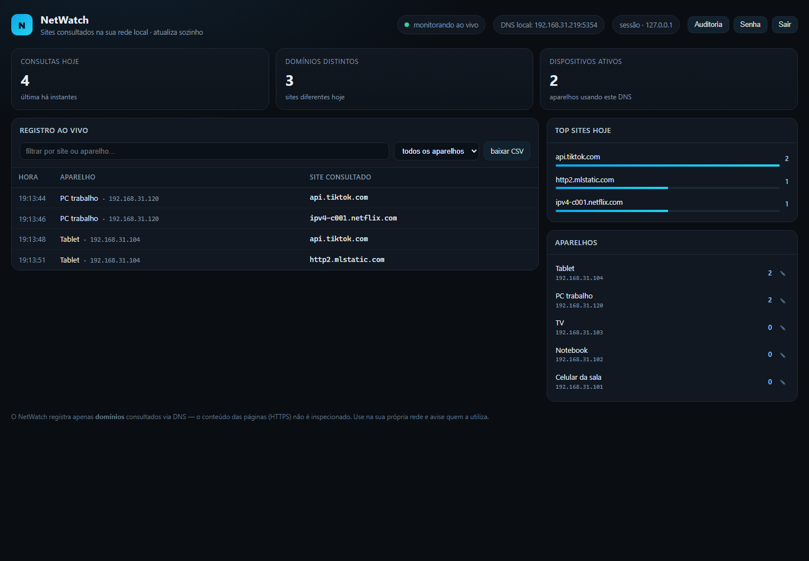
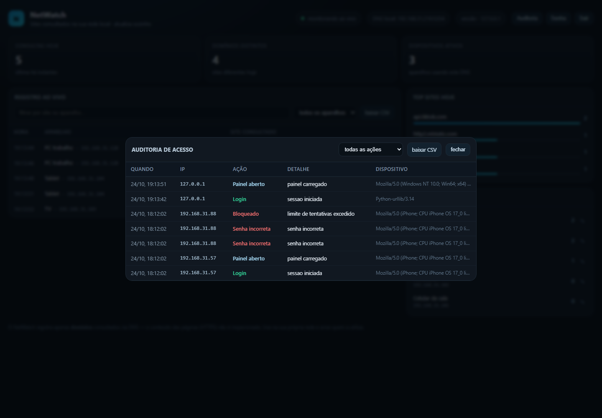
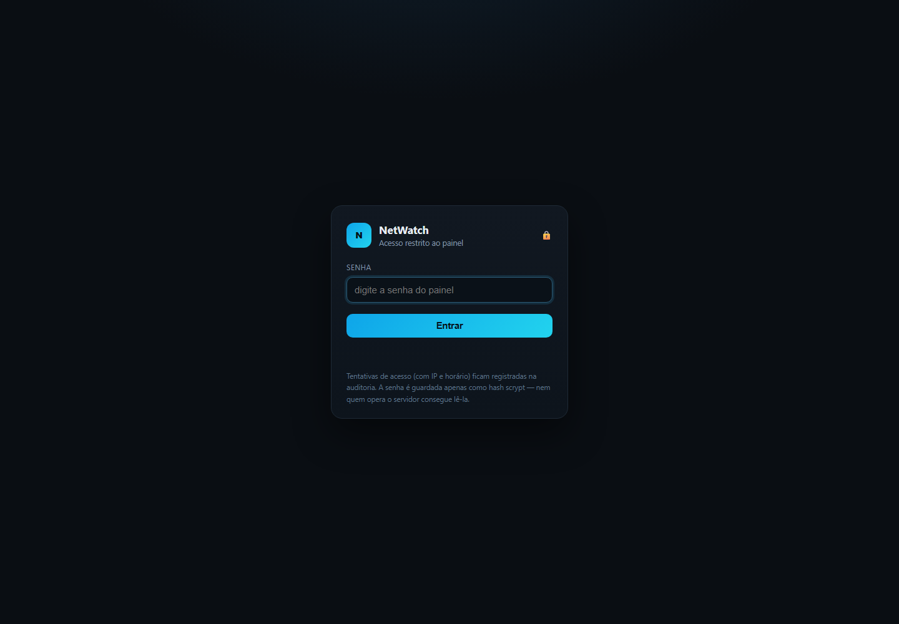

# NetWatch — quem está acessando o quê na sua rede

[](https://github.com/YuriPHB/netwatch-dns/actions/workflows/testes.yml)
[](LICENSE)
[](https://www.python.org/)

Monitor local que registra os **domínios** consultados pelos aparelhos da sua Wi‑Fi e mostra tudo num painel ao vivo, com histórico em SQLite, login por senha e auditoria de acessos.

Sem nuvem, sem conta, sem dependências externas: só Python 3.10+ e a biblioteca padrão.

## Telas

| Painel | Auditoria de acesso |
|:---:|:---:|
|  |  |

<p align="center"></p>

## Como funciona

O PC roda um **servidor DNS** (porta 53). Quando um aparelho da rede usa esse PC como DNS:

1. o aparelho pergunta "onde fica `www.instagram.com`?";
2. o NetWatch anota **quem perguntou** (IP do aparelho) e **o quê** (domínio);
3. a consulta é repassada para o DNS upstream (Cloudflare/Google) e a resposta volta normal — a navegação não fica mais lenta de forma perceptível.

O painel fica em `http://SEU_IP:8080` e atualiza sozinho a cada 2,5 s.

## Início rápido

1. **Abra o terminal como administrador** (necessário para a porta 53) e rode:

   ```bat
   iniciar-monitor.bat
   ```

   ou, manualmente:

   ```bat
   python app.py
   ```

   Na primeira execução ele pede para **criar a senha do painel** (mín. 8 caracteres, com maiúscula, minúscula e número). Sem terminal interativo, ele gera uma senha forte e mostra uma única vez no console.

2. O console mostra algo assim:

   ```
   Painel:      http://192.168.31.219:8080
   Acesso:      protegido por senha (hash scrypt)
   DNS local:   192.168.31.219:53
   ```

3. Abra o painel no PC ou no celular (mesma Wi‑Fi).

4. Aponte os aparelhos para esse DNS (veja abaixo) e navegue. As consultas aparecem na hora.

### Sem configurar nada (modo demonstração)

```bat
python app.py --demo
```

Gera consultas fictícias para você ver o painel funcionando, usando um banco separado (`netwatch-demo.db`).

### Teste automático

```bat
python selftest.py
```

Sobe DNS e painel em portas alternativas (5353/8099), envia consultas falsas e valida parser, banco, API, CSV e renomeação de aparelhos. Não precisa de admin.

## Apontar a rede para este DNS

### Opção A — no roteador (recomendado, pega todos os aparelhos)

No painel do roteador, procure **DHCP / LAN → DNS primário** e coloque o IP do PC (ex.: `192.168.31.219`). Reinicie o Wi‑Fi dos aparelhos ou aguarde a renovação do DHCP.

> Dica: deixe o IP do PC fixo (reserva DHCP) para ele não mudar.

### Opção B — aparelho por aparelho

- **Android**: Wi‑Fi → rede → *Configurações avançadas* → DNS 1 = IP do PC (modo "Estático").
- **iPhone/iPad**: Wi‑Fi → ⓘ da rede → *Configurar DNS* → Manual → adicione o IP do PC.
- **Windows**: Configurações → Rede → Propriedades → DNS → Manual → IP do PC.

### Firewall do Windows

Se o painel não abrir no celular ou o DNS não responder, libere as portas (PowerShell **como admin**):

```powershell
netsh advfirewall firewall add rule name="NetWatch DNS" dir=in action=allow protocol=UDP localport=53
netsh advfirewall firewall add rule name="NetWatch Painel" dir=in action=allow protocol=TCP localport=8080
```

## Acesso e segurança

- **Senha com hash scrypt** (n=2¹⁴, salt aleatório de 16 bytes por senha). O banco guarda `scrypt$...$hash`, nunca a senha. Nem você (nem quem abrir o `netwatch.db`) consegue lê-la.
- **Sessão por cookie `HttpOnly` + `SameSite=Strict`**, token de 256 bits. No banco fica só o SHA-256 do token, então um vazamento do banco não permite sequestrar sessões.
- **Expiração** configurável (`session_hours`, padrão 12 h) e botão **Sair** que invalida a sessão no servidor.
- **Bloqueio por força bruta**: após `login_max_attempts` (8) senhas erradas em `login_window_minutes` (10 min), o IP fica bloqueado e o evento vai para a auditoria.
- **Troca de senha pelo painel** (botão *Senha*): pede a senha atual, valida a força, derruba as outras sessões abertas e registra na auditoria.
- **Troca/reset pelo terminal**: `python app.py --set-password` (não pede a senha antiga — quem tem acesso ao console já é administrador).
- **HTTPS opcional**: `python app.py --cert cert.pem --key key.pem` passa a servir TLS 1.2+ e marca o cookie como `Secure`. Sem certificado, o tráfego é HTTP na LAN (veja limitações).

### Auditoria de acesso

Botão **Auditoria** no topo do painel. Cada evento guarda **data/hora, IP, ação, detalhe e dispositivo (User-Agent)**:

| Ação | Quando acontece |
|---|---|
| `login_ok` / `login_fail` | tentativa de entrada (certa ou errada) |
| `login_bloqueado` | IP barrado por excesso de tentativas |
| `logout` | saída pelo botão Sair |
| `painel_aberto` | abriu o painel (no máximo 1 registro por hora por IP) |
| `aparelho_renomeado` | nome amigável alterado |
| `senha_alterada` / `senha_alterada_falha` | troca de senha |
| `log_exportado` / `auditoria_exportada` | download de CSV |
| `dados_apagados` | histórico de consultas limpo |

A auditoria é filtrável por ação e exportável em CSV (`/api/audit.csv`). O polling de 2,5 s do painel **não** é auditado, para não inundar o log.

## O painel

- **Registro ao vivo**: hora, aparelho e domínio, com filtro por texto e por aparelho.
- **Cards**: consultas de hoje, domínios distintos, aparelhos ativos, última consulta.
- **Top sites hoje** e lista de **aparelhos** (clique no ✎ para dar um nome: "Celular da sala", "TV"…).
- **Baixar CSV**: exporta o histórico completo (separador `;`, abre direto no Excel).
- Consultas repetidas do mesmo aparelho ao mesmo domínio são agrupadas por 45 s (`dedupe_seconds`) para o log ficar legível.
- **Auditoria**, **Senha** e **Sair** no canto superior direito.

## Configuração (`config.json`)

```json
{
  "dns_port": 53,
  "web_port": 8080,
  "upstreams": ["1.1.1.1", "8.8.8.8"],
  "dedupe_seconds": 45,
  "retention_days": 30,
  "session_hours": 12,
  "login_max_attempts": 8,
  "login_window_minutes": 10
}
```

Opções de linha de comando: `--dns-port`, `--web-port`, `--db`, `--demo`, `--no-open`.

## Limitações (leia!)

- **Só domínios, não páginas.** Quase tudo hoje é HTTPS: o NetWatch vê `www.youtube.com`, mas não qual vídeo. Inspecionar conteúdo exigiria instalar certificado em cada aparelho (MITM) — não é o objetivo aqui.
- **Só aparelhos que usam este DNS.** Se um aparelho tem DNS próprio configurado, está em outra rede (convidado/4G) ou usa **DNS over HTTPS**, ele não aparece.
  - Desative "DNS seguro/privado" no Chrome/Edge/Firefox e no Android (Private DNS) se quiser capturar tudo.
- **Não vê tráfego de apps que usam DoH/DoT fixo** (alguns apps de mensagem).
- **Porta 53**: exige administrador e precisa estar livre (Pi-hole, outro DNS, alguns antivírus usam). Use `--dns-port 5353` para testar, mas aí os aparelhos precisam apontar para essa porta — o que o DHCP padrão não faz.
- **Não é VPN nem firewall**: não bloqueia nada, só registra.
- **HTTP não é criptografado.** O painel trafega em HTTP na rede local: a senha vai em claro no login e o cookie de sessão pode ser capturado por quem estiver na mesma rede com sniffing. Para blindar, sirva com TLS (`--cert`/`--key`, de preferência com certificado de uma CA local) ou use o painel só em rede confiável.

## Privacidade e uso responsável

O monitor é para **a sua própria rede** — controle parental, segurança, entender o que consome banda. Avise quem usa a rede que existe esse registro; monitorar terceiros às escondidas pode ser ilegal na sua jurisdição. O banco fica só no seu PC (`netwatch.db`), com retenção padrão de 30 dias.

## Arquivos

| Arquivo | Função |
|---|---|
| `app.py` | inicialização, CLI, configuração, threads auxiliares |
| `dns_proxy.py` | servidor/proxy DNS + parser de pacotes |
| `db.py` | SQLite (consultas, aparelhos, sessões, auditoria) |
| `auth.py` | hash scrypt, validação de senha, tokens de sessão |
| `web.py` | API HTTP, login, auditoria e entrega do painel |
| `static/index.html` | painel (dark, responsivo) |
| `static/login.html` | tela de login |
| `selftest.py` | teste ponta a ponta |
| `iniciar-monitor.bat` | atalho com elevação de admin |
| `config.json` | ajustes |

## Problemas comuns

| Sintoma | Causa provável / solução |
|---|---|
| `[!] Não foi possível abrir a porta DNS 53` | Falta admin, ou outro programa usa a porta. Feche-o ou use `--dns-port 5353`. |
| Painel abre no PC mas não no celular | Firewall do Windows bloqueando a 8080 (veja o comando acima). |
| Nada aparece no painel | Os aparelhos ainda usam outro DNS. Confira em `ipconfig /all` ou nas configurações do celular; reinicie o Wi‑Fi. |
| Só aparece o próprio PC | Roteador não está distribuindo este DNS via DHCP. |
| Sites do Chrome não aparecem | "DNS seguro" ativado no navegador — desative. |
| Esqueci a senha | `python app.py --set-password` no terminal (não pede a antiga). |
| Muitas tentativas erradas / 429 | Espere 10 min ou ajuste `login_max_attempts` / `login_window_minutes`. |
| Quero invalidar todos os acessos | Trocar a senha pelo painel ou por `--set-password` encerra as sessões antigas. |

## Contribuir

Sugestões, correções e novas ideias são bem-vindas. Leia o [CONTRIBUTING.md](CONTRIBUTING.md) — resumo:

1. Faça um fork e crie um branch (`feat/bloqueio-de-sites`, `fix/login-timeout`…).
2. Rode `python selftest.py` (precisa passar 100%).
3. Abra o PR explicando o problema e a solução.

Regra de ouro: **sem dependências externas** e nada de commitar `netwatch.db`, certificados ou senhas.

Ideias abertas: listas de bloqueio no DNS, alertas por Telegram/e-mail, relatórios semanais, suporte a DoH, tradução da interface.

## Licença

[MIT](LICENSE) — use, modifique e distribua livremente, mantendo o aviso de copyright.

